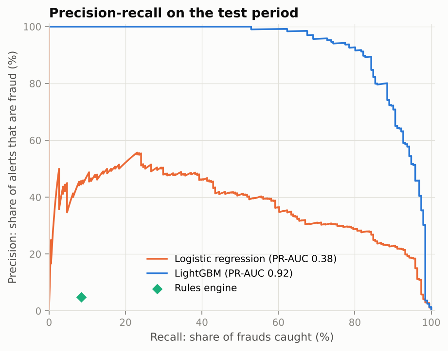
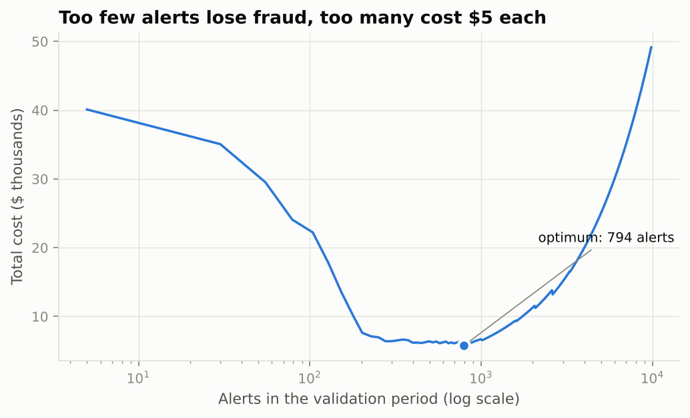
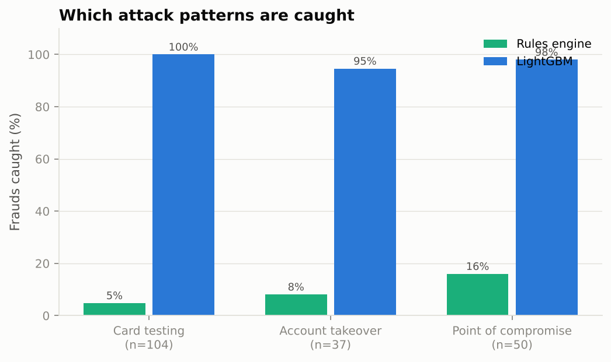
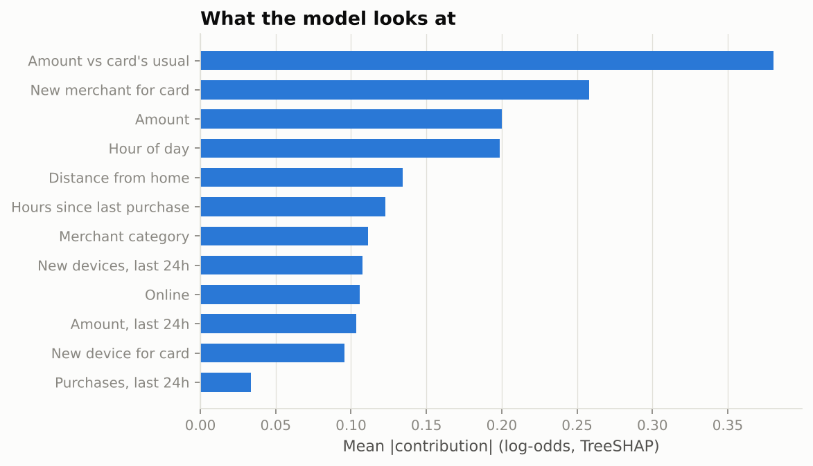

# Card Fraud Detection: Leak-Free Features and Cost-Based Alerting

[](https://github.com/c4r0l13/fraud-detection/actions/workflows/ci.yml)


A real-time fraud detection pipeline for card transactions that is judged the way a fraud team judges it: **dollars lost plus the cost of reviewing alerts**, not accuracy. It covers a transaction simulator with three realistic attack patterns, behavioural features that only use information available at authorization time, a time-based evaluation, and a threshold chosen by money.

## Results (test period: last 20 days, 97k transactions, 191 frauds)

| | Rules engine | Logistic regression | **LightGBM** |
|---|---:|---:|---:|
| PR-AUC | – | 0.378 | **0.922** |
| Frauds caught | 8% | 88% | **98%** |
| Fraud dollars caught | 22% | 90% | **99%** |
| Alerts per day | 16.5 | 36.3 | 37.5 |
| Share of alerts that are fraud | 5% | 23% | 25% |
| **Total cost** (losses + $5 per alert) | $28,601 | $7,047 | **$4,216** |
| Savings vs no screening ($34,667) | 17% | 80% | **88%** |



> ⚠️ **About the data.** The transactions are simulated (see below), so absolute numbers are more optimistic than on real traffic. The goal of the project is the *methodology*: leak-free features, time-based validation, cost-based thresholds and per-pattern evaluation. Those transfer unchanged to real data.

## Why a simulator?

Public fraud datasets are either PCA-anonymized (the Kaggle credit-card set: no feature engineering possible) or require accounts and licenses. A simulator gives something those datasets cannot: **every fraud carries the attack pattern that produced it**, so we can see *which* attacks a model catches instead of a single aggregate score.

| Pattern | What happens | Hard part |
|---|---|---|
| **Card testing** | A stolen card number is probed with 1–4 tiny online charges, then cashed out | Legitimate micro-charges (app stores, parking) are 1.5% of traffic |
| **Account takeover** | Stolen credentials, purchases of electronics, gift cards and travel | 25% use the victim's own device (malware); 60% happen in daytime |
| **Point of compromise** | A skimmed merchant leaks every card used there for 10 days; 45% of those cards are abused 2–12 days later | Mid-sized amounts at ordinary merchants |

Legitimate customers are also noisy on purpose: 30% change phones during the period, 4% of online purchases come from a one-off browser, 2% of purchases happen at night, shopping sessions create bursts, and 0.5% of purchases are unusually large. Without this noise every model scores ~1.0 and the exercise is meaningless. The first version of the simulator did exactly that, and it was rebuilt.

3,000 customers · 800 merchants · 120 days · 588k transactions · 0.19% fraud.

## Key decisions

**1. No look-ahead, ever.** Each feature is computed from the card's history *strictly before* the transaction (`closed="left"` rolling windows, shifted expanding means). A unit test builds three transactions by hand and checks the velocity counts are `[0, 1, 2]`, not `[1, 2, 3]`. This one-off error is the most common way fraud models look great offline and fail in production.

**2. Time-based split.** Train on days 1–80, choose the threshold and stop boosting on days 81–100, report on days 101–120. Fraud patterns drift, so a random split would leak future patterns into training.

**3. Threshold chosen by money.** Each alert costs $5 of analyst time; each missed fraud costs its amount. The validation cost curve has a broad, flat valley, so operations can trade a little cost for fewer alerts if analyst capacity is tight.



**4. Dollar-weighted recall.** Missing a $2 card test is not the same as missing a $900 laptop. The model catches 98% of frauds and **99% of fraud dollars**.

**5. A realistic baseline.** The comparison is against a typical legacy rule set (amount > $800, new device + amount > $300, 4+ purchases in an hour, large night purchases), not against "predict nothing". The rules catch 8% of frauds with fewer than half the model's alerts (16.5 vs 37.5 per day), so at roughly 5% precision almost all their alerts are wasted review time.



**6. Every alert explains itself.** TreeSHAP contributions give the analyst the top reasons:

```
$371.23 retail (point_of_compromise), score 0.99: Amount vs card's usual; New devices, last 24h; New merchant for card
$241.85 retail (card_testing),         score 0.98: Amount vs card's usual; New devices, last 24h; New merchant for card
```



## Features (all computed per card, past only)

| Group | Features |
|---|---|
| Amount | amount, log amount, amount vs the card's historical mean |
| Context | hour, night flag, online flag, merchant category |
| Novelty | first time with this device, first time at this merchant, new devices in the last 24h |
| Geography | distance from home (in-person only; meaningless online) |
| Velocity | hours since last purchase, purchases and amount in the last 1h and 24h, tiny charges in the last hour |

## Reproduce

```bash
git clone https://github.com/c4r0l13/fraud-detection.git
cd fraud-detection
python -m venv .venv && source .venv/bin/activate
make install
make run            # ~2 min: simulate, train, evaluate -> reports/
make run-tracked    # same, logging every model to MLflow
make mlflow-ui      # browse runs at http://localhost:5000
make test
```

## Project structure

```
fraud-detection/
├── src/fraud/
│   ├── simulator.py   # customers, merchants, legit behaviour, 3 attack patterns
│   ├── features.py    # leak-free behavioural features
│   ├── costs.py       # cost model, cost curve, threshold, dollar recall
│   └── pipeline.py    # time split, rules vs LR vs LightGBM, reports, MLflow
├── tests/             # reproducibility, no look-ahead, cost logic
└── reports/           # metrics.json, results.md, figures/
```

## Next steps

- **Label delay.** Chargebacks arrive weeks later. Training should only use labels known at training time, which reduces the effective training window.
- **Graph features for point-of-compromise.** Flag cards that visited merchants where other cards later reported fraud. This catches the breach at the source instead of waiting for each card to misbehave.
- **Real data.** Run the same pipeline on the IEEE-CIS or PaySim datasets to measure how much the simulator flatters the numbers.
